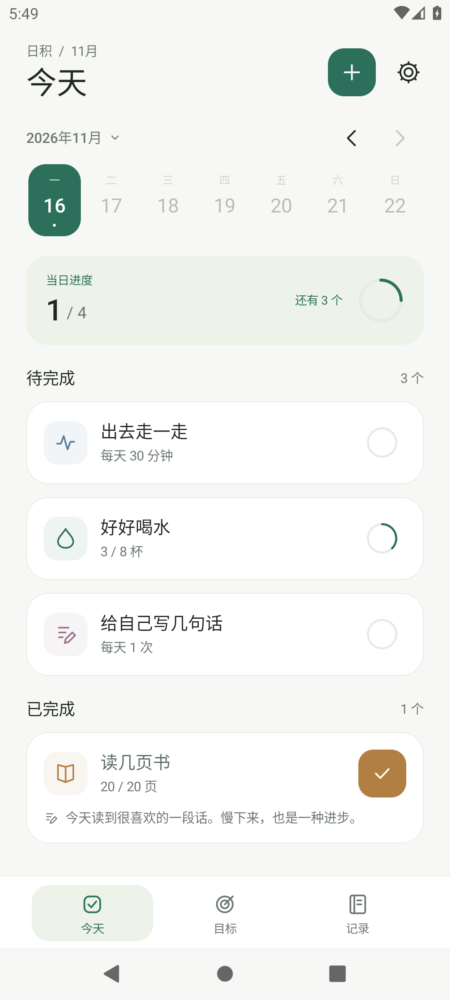
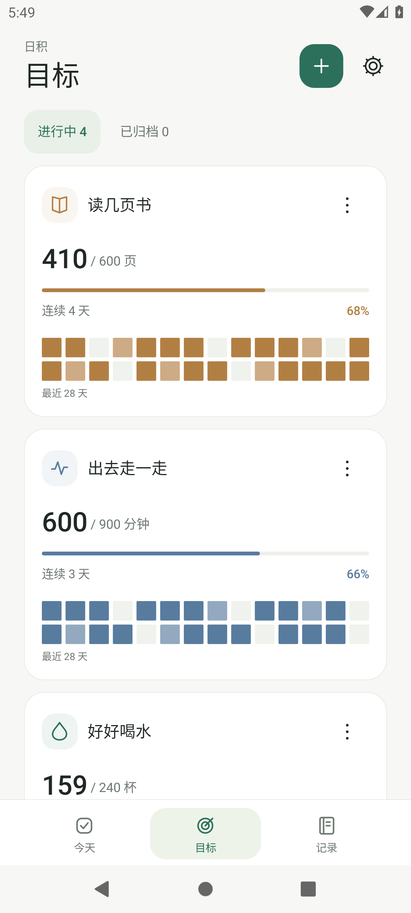
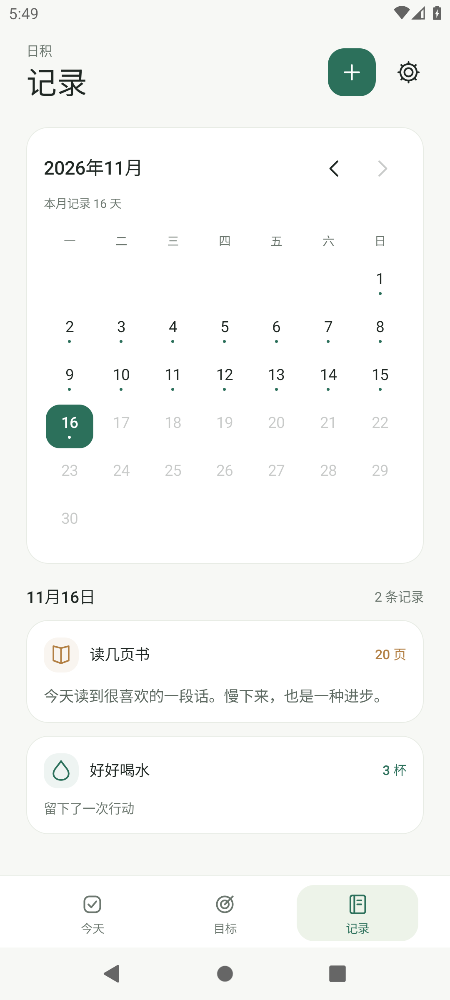

# 日积 · 原生 Android 打卡应用

Kotlin + Android 原生 Views、AppCompat 与 Material 3 组件实现。当前版本 **2.1.0**，最低支持 Android 7.0（API 24），编译和目标 SDK 为 36。项目不包含 Dart、Flutter 引擎、WebView 或 Flutter 构建插件。


## 界面预览

下图为真实运行截图，使用专门的测试示例数据；首次安装的习惯列表为空。

| 今天 | 目标 | 记录 |
| --- | --- | --- |
|  |  |  |

## 2.1 界面设计

- 今天：一周日期选择、简短完成进度、待完成与已完成分组。轻点右侧圆环打卡，轻点卡片编辑当天记录，长按卡片管理习惯。
- 目标：进行中／已归档分开显示，累计数量、进度条、连续天数和最近 28 天方格图使用真实记录计算。
- 记录：紧凑月历和当天文字记录；点击记录卡片即可编辑。
- 顶部加号统一创建入口，底部仅保留三项导航。编辑、管理和备份使用圆角底部面板，表单确认按钮保留在键盘上方。
- 暖白背景、墨色正文、低饱和绿色强调，统一线性图标、间距和圆角。图标与图表由本项目 Kotlin Canvas 绘制。

设计研究参考：[Loop Habit Tracker 的列表信息结构](https://github.com/iSoron/uhabits)、[HabitKit 的紧凑视图与连续记录方格](https://habitkit.app/)、[Material Components 官方 Bottom Sheet 实现说明](https://github.com/material-components/material-components-android/blob/master/docs/components/BottomSheet.md)。页面和图标由本项目实现，未引入参考项目的源码或图片资源。

## 功能

- 自定义任务名称、每日数量、单位、累计目标和颜色。
- 每日一键打卡，手动编辑实际总量，支持小数和纯文字日记。
- 日期切换、过去日期补记、月历、历史记录、连续达标天数。
- 编辑、归档、恢复任务，以及确认后删除任务或清除当天记录。
- 复制 JSON 备份和粘贴恢复；恢复前验证格式并确认替换。
- 编辑任务、记录时保存草稿以应对屏幕旋转和 Activity 重建。

## 打开与构建

使用 Android Studio 直接打开仓库根目录。需要 JDK 17 或以上（开发验证使用 Android Studio 自带 JDK 21）、Android SDK 36。首次构建需要联网下载 Gradle 和 Maven 依赖，不需要 Flutter SDK 或 NDK。

在根目录的 `local.properties` 中配置自己的 Android SDK 路径，或让 Android Studio 自动生成：

```properties
sdk.dir=/your/path/to/Android/sdk
```

```sh
./gradlew :app:assembleDebug
./gradlew :app:testDebugUnitTest :app:lintDebug
```

APK 输出位置：`app/build/outputs/apk/debug/app-debug.apk`。当前 APK 使用开发机的调试签名；正式发行需另行配置并保管签名密钥。

## 旧版数据兼容

包名继续使用 `com.amiao.daily_check`。以相同签名覆盖安装时，首次运行会读取 Flutter 版的 `FlutterSharedPreferences` / `flutter.daily_check_v1`，校验后写入原生应用私有文件 `files/habits-v1.json`。旧版偏好文件保留不动；原生文件存在后以原生文件为准，避免旧数据覆盖新记录。迁移失败或本地文件损坏时显示读取错误，支持重试或恢复备份，不会静默清空数据。

备份继续沿用 version 1 JSON 格式。卸载应用或清除数据会删除本地记录，建议手动保管备份。数据用 `AtomicFile` 原子写入；保存失败时不更新界面中的任务状态。

## 源码结构

- `app/src/main/kotlin/com/amiao/daily_check/MainActivity.kt`：原生每日、目标、记录页面、系统日期选择器和 Material 3 底部编辑面板。
- `app/src/main/kotlin/com/amiao/daily_check/Visuals.kt`：线性图标、进度圆环和 28 天方格图。
- `app/src/main/kotlin/com/amiao/daily_check/Models.kt`：任务、每日记录、日期和 JSON 校验。
- `app/src/main/kotlin/com/amiao/daily_check/HabitRepository.kt`：持久化和旧数据迁移。
- `app/src/test/`：JUnit 模型、格式、小数、连续打卡和异常数据测试。
- `app/src/androidTest/`：独立测试文件中的迁移、耐久保存、损坏数据保护，以及原生 Activity 启动、三项导航、底部编辑面板、未保存草稿在 Activity 重建后恢复的测试。

## 验证

2026-11-16，PGKM10 / Android 15 真机已覆盖安装 2.1.0，升级前后原有数据逐项一致。已验证创建习惯、圆环打卡、底部编辑面板、键盘展开时保存按钮可见、删除确认；测试任务已清理。模拟器另检查 320dp 窄屏、1.3 倍字体、空列表和多习惯示例。另在 Android 11 模拟器运行 instrumentation 测试：

```sh
./gradlew :app:assembleDebugAndroidTest
adb -s <device> install -r app/build/outputs/apk/debug/app-debug.apk
adb -s <device> install -r app/build/outputs/apk/androidTest/debug/app-debug-androidTest.apk
adb -s <device> shell am instrument -w com.amiao.daily_check.test/com.amiao.daily_check.NativeSmokeInstrumentation
```

Android 15/16 的系统栏和键盘区域通过 WindowInsets 处理，参考 [Android 官方系统栏适配文档](https://developer.android.com/develop/ui/views/layout/edge-to-edge)。

当前范围为离线个人打卡：每天重复任务、累计数量目标、文字记录。账号、云同步、提醒、图片、周频次和截止日期尚未实现。
